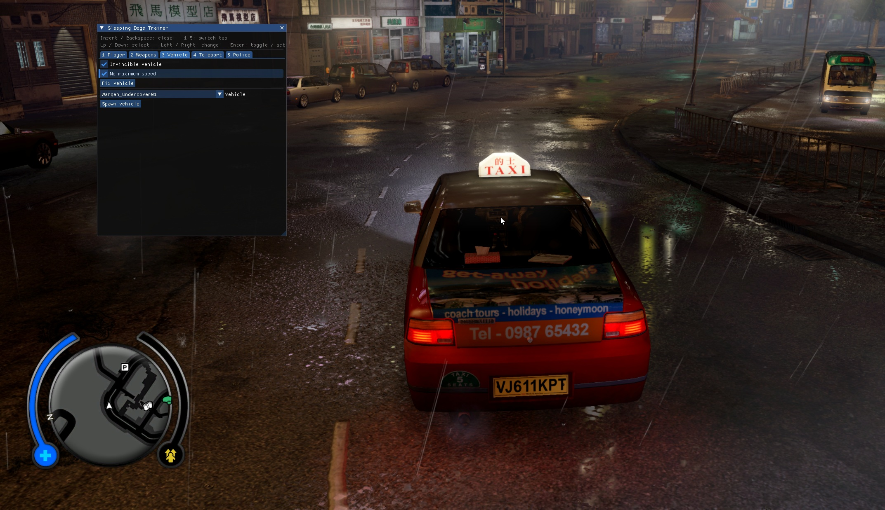

# Sleeping Dogs: Definitive Edition Trainer

A standalone in-game trainer for Sleeping Dogs: Definitive Edition (Steam, `sdhdship.exe`, 64-bit).



It loads as a proxy `xinput9_1_0.dll`: the game picks it up from its own folder, every XInput call is passed on to the real `System32\xinput9_1_0.dll`, and the trainer starts in the background. It doesn't depend on ReShade or any other mod loader, and works alongside them.

## Building

Requires Visual Studio 2022 with the "Desktop development with C++" workload (MSVC x64, Windows SDK, the bundled CMake and Ninja).

```
build.cmd              # RelWithDebInfo -> build\x64-release\xinput9_1_0.dll
build.cmd x64-debug    # Debug          -> build\x64-debug\xinput9_1_0.dll
```

MinHook and Dear ImGui are downloaded by CMake on first configure (pinned tags). To copy the DLL into the game folder after every build, configure once with
`-DSDT_GAME_DIR="G:/SteamLibrary/steamapps/common/SleepingDogsDefinitiveEdition"`.

## Installing

Copy `xinput9_1_0.dll` next to `sdhdship.exe`. Delete it to uninstall.

Settings are saved to `SDTrainer.ini` and the log to `SDTrainer.log`, both in the game folder.

## Controls

The menu works with the mouse or the keyboard. These keys are also listed at the top of the menu.

| Key | Action |
|---|---|
| Insert | Open / close the menu |
| Backspace | Close the menu |
| 1–6 (number row) | Switch tab |
| Up / Down | Select an option (wraps around; hold to repeat) |
| Left / Right | Change the selected value (cycle a list, heat level, hour, game speed −/+) |
| Enter | Toggle a checkbox / press a button / pick a favorite |
| Delete | Remove the selected favorite |

Favorites: on the Weapons and Vehicle tabs, "Add to favorites" saves the weapon or vehicle selected in the dropdown. Favorites are listed under the dropdown; clicking one (or Enter) selects it in the dropdown, and Delete removes the selected one. They are saved in `SDTrainer.ini` under `[Favorites]`.

While the menu is open, these keys are hidden from the game; every other key still reaches it.

## Layout

| Path | Contents |
|---|---|
| `src/proxy/` | XInput forwarding and the export list |
| `src/dllmain.cpp` | Starts the trainer thread (only inside `sdhdship.exe`) |
| `src/core/` | DX11 Present hook, ImGui menu, window-message input hook, config, logging, signature scanner |
| `src/game/` | Wrappers around game functions (SkookumScript bindings); currently stubs |
| `src/features/` | Menu tabs, persisted toggles, per-frame re-apply logic |

## Known limitations

- While the menu is open the game keeps receiving input, except the menu keys above, mouse input over the trainer window, and keyboard input while typing in a text field. Moving the mouse outside the menu still turns the camera.
- If ReShade is installed, its effects are applied after the menu is drawn, so they also affect the menu's look.
